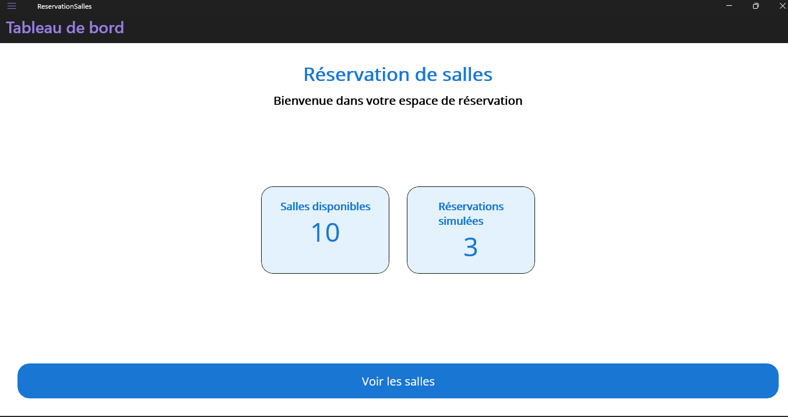
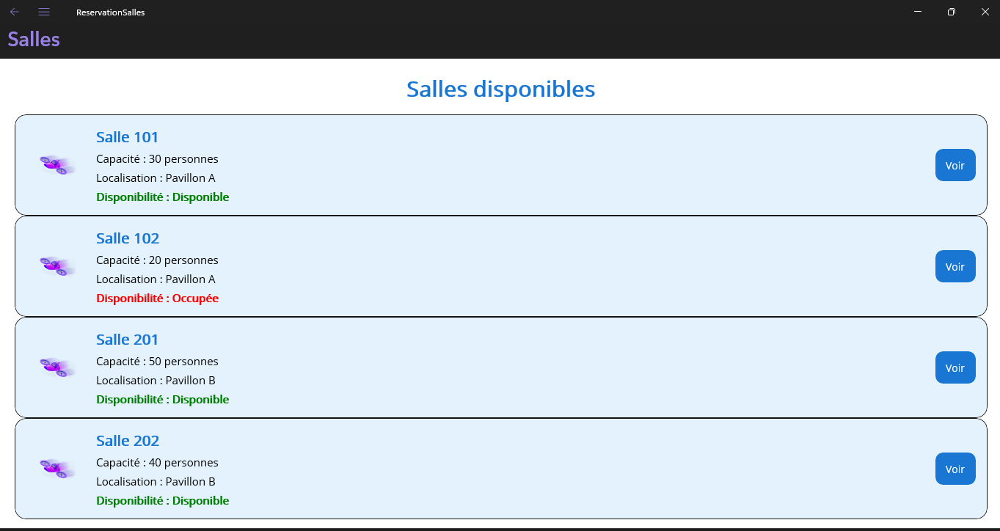
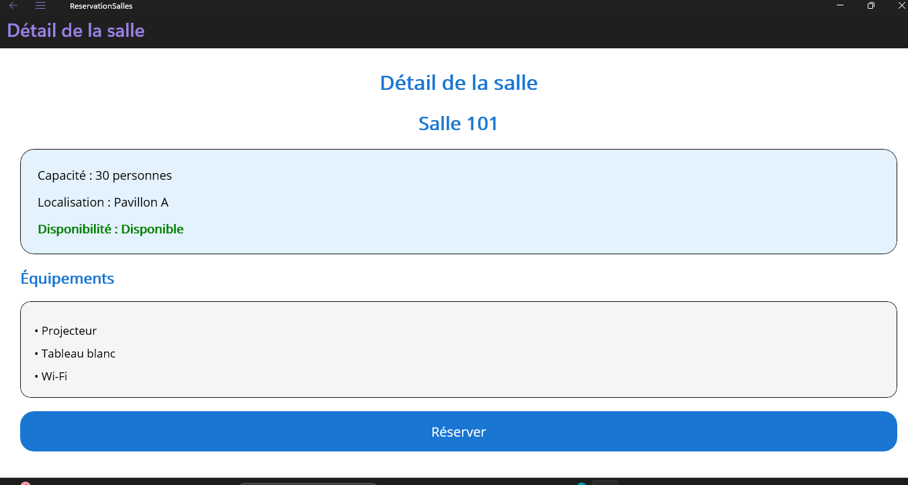
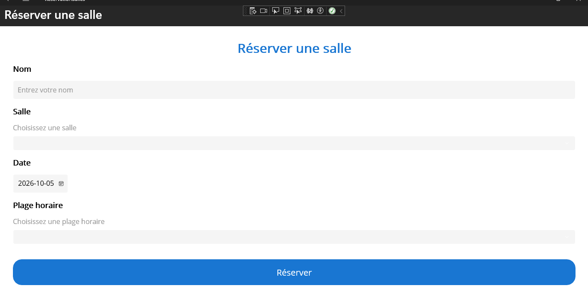
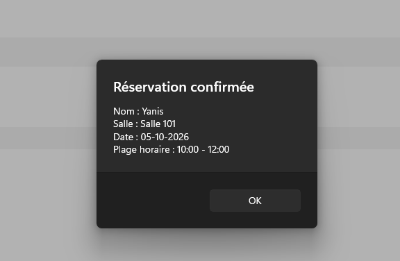
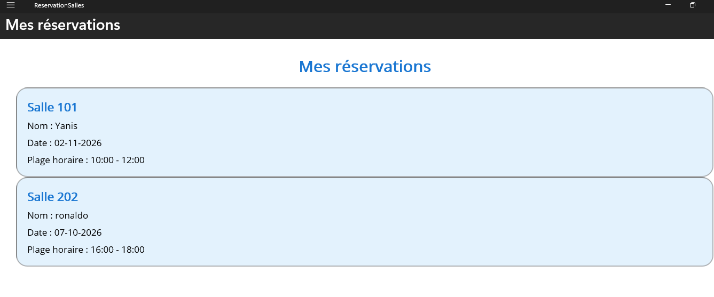

# ReservationSalles

Application .NET MAUI permettant de consulter les salles disponibles et de gérer des réservations simulées.

## Présentation du projet

ReservationSalles est une application développée avec .NET MAUI dans le cadre du cours de programmation.

L'application permet de consulter les salles, d'afficher leurs informations détaillées, de faire une réservation et de consulter les réservations effectuées.

Les données du projet sont des données de démonstration. Les réservations sont conservées en mémoire pendant l'exécution de l'application et ne sont pas enregistrées dans une base de données.

## Fonctionnalités

### Tableau de bord

Le tableau de bord permet de :

- Afficher le nombre de salles disponibles
- Afficher le nombre de réservations simulées
- Accéder à la liste des salles

### Liste des salles

La liste affiche les informations principales de chaque salle :

- Nom de la salle
- Capacité
- Localisation
- Disponibilité
- Équipements
- Bouton pour consulter les détails

Les salles utilisées dans l'application sont :

- Salle 101
- Salle 102
- Salle 201
- Salle 202

### Détail d'une salle

La page de détail permet de consulter :

- Le nom de la salle
- La capacité
- La localisation
- La disponibilité
- Les équipements disponibles

Un bouton **Réserver** permet d'accéder au formulaire de réservation.

### Réservation

Le formulaire de réservation permet de saisir :

- Le nom de l'utilisateur
- La salle
- La date
- La plage horaire

Lorsque l'utilisateur accède au formulaire depuis la page de détail, la salle sélectionnée est automatiquement transmise au formulaire.

### Validation

Le formulaire vérifie les informations nécessaires avant de confirmer la réservation.

Les informations vérifiées sont :

- Le nom de l'utilisateur
- La salle sélectionnée
- La plage horaire

Une alerte est affichée lorsqu'une information obligatoire est manquante.

Après une saisie valide, une confirmation affiche :

- Le nom de l'utilisateur
- La salle
- La date
- La plage horaire

### Vérification des disponibilités

L'application vérifie si la salle est déjà réservée pour la même date et la même plage horaire.

Une même salle ne peut donc pas être réservée deux fois au même moment.

Si la salle est déjà réservée, un message **Salle indisponible** est affiché et la nouvelle réservation n'est pas ajoutée.

### Mes réservations

La page **Mes réservations** permet d'afficher les réservations effectuées pendant l'exécution de l'application.

Pour chaque réservation, l'application affiche :

- Le nom de la salle
- Le nom de l'utilisateur
- La date
- La plage horaire

La page est accessible directement depuis le menu de navigation.

## Navigation

Le parcours principal de l'application est :

```text
Tableau de bord
       ↓
Liste des salles
       ↓
Détail d'une salle
       ↓
Réserver
       ↓
Formulaire de réservation
       ↓
Validation
       ↓
Confirmation
       ↓
Mes réservations
## Technologies utilisées

- C#
- .NET MAUI
- XAML
- Visual Studio 2022
- Git
- GitHub

## Structure du projet

```text
ReservationSalles
│
├── Images
│   ├── dashboard.png
│   ├── salles.png
│   ├── salle-detail.png
│   ├── reservation.png
│   ├── reservation-confirmation.png
│   └── reservations.png
│
├── Models
│   ├── Salle.cs
│   ├── Reservation.cs
│   └── ReservationService.cs
│
├── Pages
│   ├── DashboardPage.xaml
│   ├── DashboardPage.xaml.cs
│   ├── SallesPage.xaml
│   ├── SallesPage.xaml.cs
│   ├── SalleDetailPage.xaml
│   ├── SalleDetailPage.xaml.cs
│   ├── ReservationPage.xaml
│   ├── ReservationPage.xaml.cs
│   ├── ReservationsPage.xaml
│   └── ReservationsPage.xaml.cs
│
├── Platforms
│
├── Resources
│   └── Styles
│
├── App.xaml
├── App.xaml.cs
├── AppShell.xaml
├── AppShell.xaml.cs
└── README.md
ReservationSalles
│
├── Images
│   ├── dashboard.png
│   ├── salles.png
│   ├── salle-detail.png
│   ├── reservation.png
│   ├── reservation-confirmation.png
│   └── reservations.png
│
├── Models
│   ├── Salle.cs
│   ├── Reservation.cs
│   └── ReservationService.cs
│
├── Pages
│   ├── DashboardPage.xaml
│   ├── DashboardPage.xaml.cs
│   ├── SallesPage.xaml
│   ├── SallesPage.xaml.cs
│   ├── SalleDetailPage.xaml
│   ├── SalleDetailPage.xaml.cs
│   ├── ReservationPage.xaml
│   ├── ReservationPage.xaml.cs
│   ├── ReservationsPage.xaml
│   └── ReservationsPage.xaml.cs
│
├── Platforms
│
├── Resources
│   └── Styles
│
├── App.xaml
├── App.xaml.cs
├── AppShell.xaml
├── AppShell.xaml.cs
└── README.md
## Navigation entre les pages

La navigation de l'application utilise `AppShell` et les routes .NET MAUI.

Les principales pages sont :

- `DashboardPage`
- `SallesPage`
- `SalleDetailPage`
- `ReservationPage`
- `ReservationsPage`

La salle sélectionnée est transmise de `SalleDetailPage` vers `ReservationPage`.

Les réservations effectuées sont conservées dans `ReservationService` pendant l'exécution de l'application.

## Captures d'écran

### Tableau de bord



### Liste des salles



### Détail d'une salle



### Formulaire de réservation



### Confirmation de réservation



### Mes réservations



## Guide d'exécution

1. Ouvrir le projet `ReservationSalles` dans Visual Studio 2022.
2. Vérifier que .NET MAUI est installé.
3. Ouvrir la solution du projet.
4. Sélectionner **Windows Machine** comme cible d'exécution.
5. Appuyer sur **F5** pour lancer l'application.
6. Le tableau de bord s'affiche au démarrage.
7. Cliquer sur **Voir les salles**.
8. Sélectionner une salle et cliquer sur **Voir**.
9. Consulter les détails de la salle.
10. Cliquer sur **Réserver**.
11. Entrer le nom de l'utilisateur.
12. Choisir une salle.
13. Choisir une date.
14. Choisir une plage horaire.
15. Cliquer sur **Réserver**.
16. Une confirmation de réservation s'affiche.
17. Ouvrir le menu **☰**.
18. Cliquer sur **Mes réservations** pour consulter les réservations effectuées.

## Gestion des réservations

Les réservations sont conservées dans une liste en mémoire à l'aide de `ReservationService`.

L'application vérifie qu'une même salle ne possède pas déjà une réservation pour la même date et la même plage horaire.

Si une réservation identique existe déjà, l'application affiche un message indiquant que la salle est indisponible.

Les réservations ne sont pas sauvegardées de façon permanente et sont perdues lorsque l'application est arrêtée.

## Données

Les salles utilisées dans l'application sont des données de démonstration.

Les réservations sont simulées et conservées temporairement en mémoire.

Aucune base de données n'est utilisée dans cette version du projet.

## Projet

Projet réalisé dans le cadre du cours de programmation avec .NET MAUI.